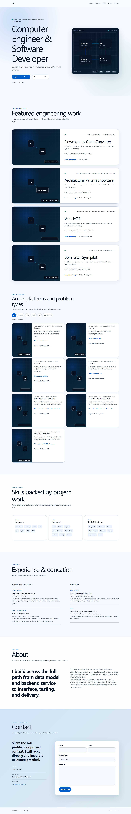

# React portfolio candidate

This directory contains the separate Next.js candidate for Luiz Fehlberg's portfolio. The existing static portfolio remains at the repository root and continues to run independently.



## What is included

- Next.js App Router with TypeScript and Tailwind CSS v4
- Framer Motion transitions limited to `transform` and `opacity`
- Six featured projects, two additional engineering projects, eleven Android projects and three earlier case-study routes
- Filterable project explorer with honest project and preview labels
- Accessible contact form with client-side validation and Formspree delivery
- Privacy-limited Vercel Analytics events with no free-text form data
- Responsive coverage at 320, 390, 768, and 1440 pixels
- Vitest, React Testing Library, Playwright, and axe checks

The Android showcase at `#android` links to public browser demos and full emulator screenshots. Case studies describe verification and demo scope and link to public debug APKs where available. The Android catalogue is synchronized from the root portfolio by `scripts/prepare-showcase.cjs`.

Current integration evidence and captures are in `../docs/showcase/`. The historical screenshots below document the earlier candidate baseline. The production preview runs on port 3100 after `npm run build` and `npm run start -- --hostname 127.0.0.1 --port 3100`.

## Run locally

Requirements: Node.js and npm.

```powershell
npm.cmd install
npm.cmd run dev
```

Open `http://localhost:3000`.

## Verification

```powershell
npm.cmd run lint
npm.cmd run typecheck
npm.cmd test
npm.cmd run build
npm.cmd run test:e2e
npm.cmd run format:check
```

Playwright uses Chromium and starts the candidate on port 3100. Install the browser once when needed:

```powershell
npm.cmd exec playwright install chromium
```

Alternatively, use the installed Chrome with `$env:PLAYWRIGHT_CHANNEL='chrome'` before the E2E command. Integration verification uses this option on the current machine.

## Configuration

Set `NEXT_PUBLIC_SITE_URL` to the final HTTPS origin before deployment so canonical, sitemap, robots, and social metadata use the production URL. No environment file is committed.

The contact form uses the existing Formspree endpoint. Vercel Analytics is rendered only in a Vercel environment. The implementation emits only the approved event names defined in `src/lib/analytics.ts`; it does not send contact-form content.

## Release gates

- Replace the text-based About treatment only after a new approved profile photo is supplied.
- Add a YouTube profile only after the owner supplies a current public URL; the previously inferred handle returned 404 and is not shipped.
- Confirm the LinkedIn profile in a normal signed-out browser before publishing; LinkedIn returned its automated-request block during the live link check.
- Supply and approve a current CV before exposing a CV link or enabling its analytics event.
- Run a real screen-reader smoke test. Automated semantics, keyboard, reflow, contrast, and reduced-motion checks are already covered, but they do not substitute for NVDA, JAWS, VoiceOver, or TalkBack.
- Deployment requires explicit authorization and production environment configuration.

See [the accessibility audit](docs/accessibility-audit.md) for the tested scope and remaining manual checks.

## Mobile preview


